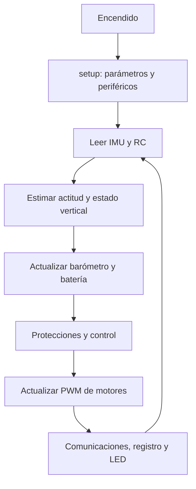

# 2. Arquitectura del software

| Subsistema | Archivos | Responsabilidad |
|---|---|---|
| Aplicación | `CF-Drone.ino` | Inicialización y ciclo principal |
| Control | `control.ino`, `control.h`, `pid.h` | Modos de vuelo, lazos PID y mezcla |
| IMU | `imu.ino`, `drivers/MPU9250.*`, `drivers/invensense_imu.*` | Lectura y calibración |
| Estimación | `estimate.ino`, `position_ekf.ino`, `quaternion.h`, `vector.h` | Actitud y estado vertical |
| Motores | `motors.ino` | Salidas PWM |
| Sensores auxiliares | `barometer.ino`, `battery.ino` | Altitud y tensión |
| Comunicaciones | `rc.ino`, `mavlink.ino`, `wifi.ino`, `web_rc.ino` | RC, telemetría y control web |
| Seguridad | `safety.ino` | Gestión de fallos |
| Configuración | `board_config.h`, `parameters.ino` | Pines y parámetros persistentes |
| Soporte | `util.h`, `lpf.h`, `time.ino`, `log.ino`, `cli.ino` | Utilidades, filtros, temporización y consola |

## Flujo principal

## Control
En `control.ino` se distinguen un lazo externo de actitud y uno interno de velocidad angular. El externo genera referencias de velocidad; el interno calcula órdenes de torque que se mezclan con el empuje de los cuatro motores.

## Estimación
`estimate.ino` integra velocidades angulares en un cuaternión y corrige con acelerómetro. `position_ekf.ino` estima altura, velocidad vertical y sesgo del acelerómetro, con corrección barométrica.

## Decisión de organización
Los archivos `.ino` permanecen en el mismo directorio de sketch. Moverlos a subcarpetas sin migración y compilación puede romper la generación de prototipos y las rutas de inclusión. Esta primera organización separa documentación, no altera el firmware.
